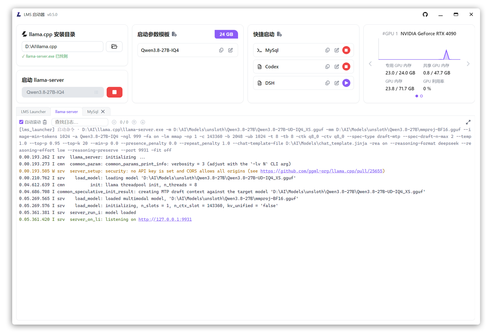

# LMS 启动器

<div align="center"></div>

Windows 桌面版 llama-server 图形化启动器, 基于 llama.cpp, 无需命令行, 选择模板后一键启动本地大模型推理服务

主要功能:

- 记住 llama.cpp 安装位置, 每次启动自动校验
- 常用启动参数保存为模板, 覆盖模型文件、端口、GPU 层数、量化、采样、投机解码等参数
- 一键启动与停止服务, 完整启动命令记入日志
- 快捷启动项在应用内运行, 命令行项开一个终端页签, 可执行程序直接启动
- 启动器自身与 llama.cpp 都能在应用内检查并安装更新
- 显卡利用率与显存实时监控, 模板显存占用估算
- 日志与终端多页签, 实时滚动、查找、清空、全屏
- 中英文界面, 支持代理
- 系统托盘运行, 关闭窗口仅隐藏, 服务继续运行

## 下载安装

前往 [Releases](https://github.com/Gelomen/lms_launcher/releases) 页面下载 `.zip` 压缩包, 解压后运行 `lms_launcher.exe`

配置与缓存全部写在 exe 所在目录, 升级时覆盖解压即保留原有配置

## 编译

环境要求为 `Windows` 和 `Node.js`

1. 安装依赖:

```bash
npm install
```

2. 开发模式, 热重载并自动打开应用窗口:

```bash
npm run dev
```

3. 构建前端与主进程:

```bash
npm run build
```

4. 打包, 一键完成清理、构建与打包:

```bash
.\build.bat
```

产物为 `dist-release/win-unpacked/lms_launcher.exe`

5. 生成发布压缩包, 产物为 `lms-launcher-v<version>-win64.zip`:

```bash
pwsh -File scripts\package-zip.ps1
```

6. 运行测试:

```bash
npm test
```

## 卡片功能

| 卡片 | 说明 |
|------|------|
| llama.cpp 安装目录 | 选择包含 `llama-server.exe` 的目录, 校验通过后自动保存, 下次启动自动读取 |
| 启动 llama-server | 下拉选择模板后启动, 运行中可停止, 优雅停止, 3 秒无响应则强制结束进程 |
| 启动参数模板 | 新建、编辑、复制、删除模板, 模型文件必填, 枚举参数下拉选择, 文件参数直接选文件; 显存按钮配置显卡显存总量, 编辑模板时据此估算占用 |
| 快捷启动 | 保存常用命令行与可执行程序, 一键启动, 命令行项在终端页签里交互, 可执行程序项直接运行, 支持多行命令与管理员权限 |
| 系统 GPU | 每 2 秒采样显卡利用率与显存占用, 多显卡时左右轮播切换 |
| 日志卡 | 启动器与 llama-server 两个固定页签, 每个运行中的快捷启动项一个终端页签, 终端支持查找、清空、重新启动与配色 |

## 参数表

`configs/llama_params.yaml` 随包分发, 是参数名、必填项、枚举选项与默认值的唯一来源, 替换该文件即可调整模板可用的参数

## 托盘与设置

关闭窗口仅隐藏到托盘, 托盘右键菜单提供打开、检查更新、设置、退出, 退出时停止 llama-server

检查更新弹窗同时处理启动器自身与 llama.cpp, llama.cpp 正在运行时先停止服务再安装更新

设置里切换语言与配置代理